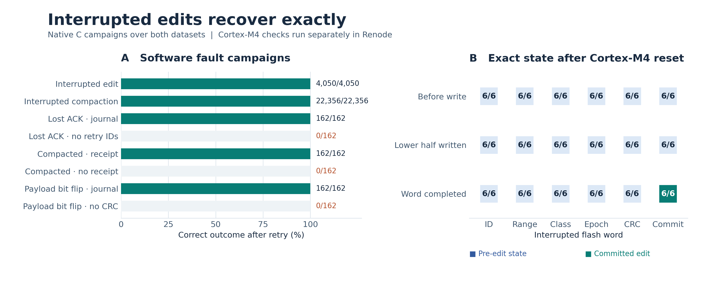

# Exact, crash-consistent label correction for wearable HAR

A Cortex-M4 can correct a past calibration label after discarding its raw inertial samples. The firmware stores exact **44-byte block summaries**, applies corrections through a **24-byte transaction**, and retains an acknowledgement for the latest request after compaction and reset.



## Results

| Primary two-second label-error setting | HAPT | MotionSense |
|---|---:|---:|
| Source-only macro-F1 | 81.05% | 77.18% |
| Macro-F1 with wrong calibration labels | 77.92% | 83.86% |
| Macro-F1 after exact correction | 80.15% | 88.69% |
| Paired gain over wrong labels, 95% CI | +2.22 pp [−0.31, +4.78] | +4.83 pp [+2.30, +7.50] |

The packed journal matches all full-vector predictions across 486 participant, seed, and edit-duration cases. The evaluation includes 10,368 edits in sequential stress runs, 192 Renode resets for the packed journal, and 30 Renode resets for the matched snapshot. A 24-block calibration stores 1,056 bytes of packed summaries, 2,400 bytes of unpacked summaries, or 4,704 bytes of vectors. The HAPT source-only model remains slightly ahead. See [firmware comparisons](results/tables/firmware_cost.md), [recovery and ablations](results/tables/recovery.md), and [stress runs](results/tables/stress_sequences.md).

For a clean two-block edit, the packed journal executes 2,728 guest instructions versus 3,820 for incremental vectors and 3,418 for RAM-cached vectors. It programs 24 bytes per append and 35.25 bytes per edit when a clean journal fills all 16 slots before compaction. The matched snapshot programs 180 bytes and erases a sector for each edit. The [write-cost figure](results/figures/fig6_journal_write_cost.png) also shows the measured eight-slot host stress workload.

## Reproduce

Use Linux, Python 3.11 or 3.12, a native C compiler, Make, Arm GNU GCC, and Renode. The saved results use Arm GNU GCC 12.2.1 and Renode 1.17.0. Install `build-essential` and `gcc-arm-none-eabi` on Debian or Ubuntu. Use the [portable Renode release](https://github.com/renode/renode/releases/tag/v1.17.0) and add `renode` to your PATH.

```bash
python -m venv .venv
source .venv/bin/activate
python -m pip install -r requirements.txt
python -m unittest discover -s tests -v
python -m har.experiments
python -m har.emulator
python -m har.report
python tools/build_notebooks.py
python tools/verify_results.py
```

Run the commands from the repository root. The data loader downloads and verifies both archives before caching features. See [dataset provenance](DATASETS.md) for pinned inputs and offline paths. Pass `--renode /path/to/renode --cross /path/to/arm-none-eabi-` if the tools are installed elsewhere. Use `--in-process` with the notebook builder where local Jupyter sockets are restricted. The executed notebooks open with results included. Set `HAR_RERUN_DATA=1` or `HAR_RERUN_RENODE=1` to rerun the corresponding pipeline from the notebooks.

| Location | Contents |
|---|---|
| [firmware/](firmware/) | C encoder, exact block packing, journal, baselines, and Cortex-M4 platform |
| [har/](har/) | Dataset pipeline, participant-level evaluation, stress tests, Renode harness, and figures |
| [notebooks/](notebooks/) | Three executed Jupyter notebooks with HTML exports |
| [results/](results/) | Raw CSVs, nine ablations, LaTeX tables, six figures, and validation summary |
| [METHOD.md](METHOD.md) | Invariants, fault assumptions, evaluation protocol, and measurement definitions |

The target results are simulated instruction and flash-operation counts. The recognition experiment uses controlled annotation errors.
